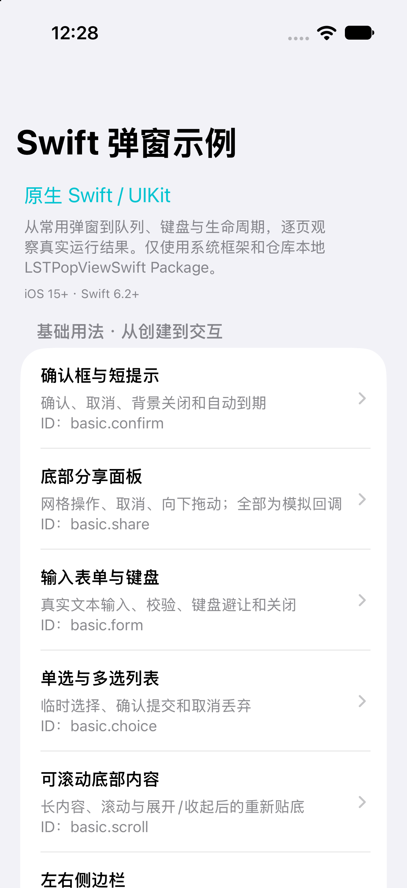
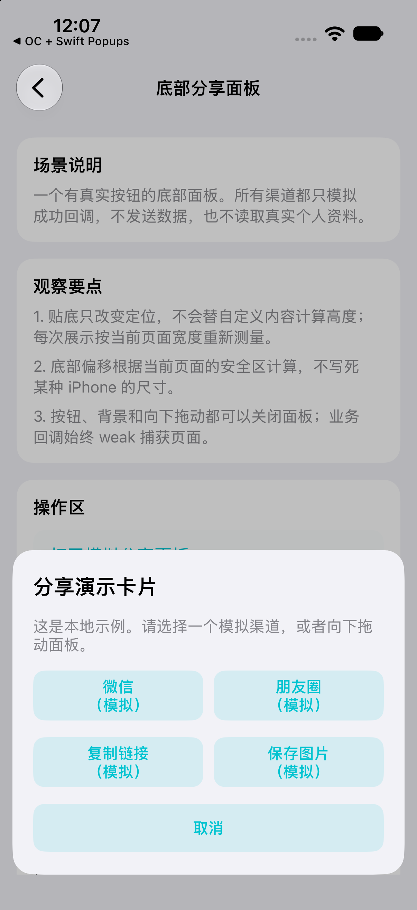
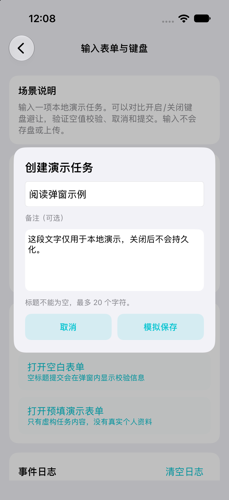

# LSTPopView

**简体中文** | [English](README_EN.md)

[](https://developer.apple.com/ios/) [](#选择版本) [](https://cocoapods.org/pods/LSTPopView) [](LICENSE)

LSTPopView 是一个 UIKit 自定义弹窗库，提供 **Objective-C** 和 **原生 Swift** 两套实现。业务负责内容和交互，库负责展示、动画、遮罩、队列及关闭流程，适用于确认框、底部面板、输入表单、选择列表、侧边栏等场景。

- 自定义 `UIView` 内容，支持纯代码或 XIB；位置、偏移、圆角和背景可配置。
- 弹入与退出动画可分别选择，支持拖拽、轻扫、回弹和点击背景关闭。
- 支持分组、优先级、堆叠、单显示模式，以及按容器查询和管理弹窗。
- 提供生命周期回调、多代理、键盘避让和倒计时接口。
- 原生 Swift 版使用 `@MainActor` 隔离界面状态，支持多 Scene 上下文失效、减少动态效果和可访问性焦点恢复。

## 目录

- [选择版本](#选择版本)
- [先运行 Demo](#先运行-demo)
- [安装](#安装)
- [快速使用](#快速使用)
- [常用配置](#常用配置)
- [生命周期与接入规则](#生命周期与接入规则)
- [OC 与 Swift 共存](#oc-与-swift-共存)
- [Swift 场景示例](#swift-场景示例)
- [验证与开发](#验证与开发)
- [OC 动画预览](#oc-动画预览)
- [更新记录与反馈](#更新记录与反馈)
- [许可证](#许可证)

## 选择版本

| 项目 | Objective-C | 原生 Swift |
|---|---|---|
| 模块 / Pod | `LSTPopView` | `LSTPopViewSwift` |
| 实现 | Objective-C / UIKit | Swift / UIKit，独立实现 |
| 部署下限 | podspec 声明 iOS 8.0 | iOS 15.0 |
| Swift 工具链 | 无新增要求 | Swift 6.2+，Xcode 26+，Swift 6 语言模式 |
| 第三方依赖 | `LSTTimer` | 无，仅系统框架 |
| 安装方式 | CocoaPods、手动集成 | Swift Package Manager、独立 CocoaPod、手动集成 |
| 源码 | [OC 源码](LSTPopView/Classes/Code) | [Swift 源码](Swift/Sources/LSTPopViewSwift) |

已有 OC 项目继续使用 `pod 'LSTPopView'` 即可，无需迁移。两个模块可以独立安装，也可以在同一个满足 Swift 版要求的 App 内共存。Swift 版的系统和编译器要求不会传递给只安装 OC Pod 的项目。

表中的系统下限来自各自的包配置，不代表全部历史系统和设备都完成过运行验证。

## 先运行 Demo

| 入口 | 用途 | 运行方式 |
|---|---|---|
| [Objective-C Demo](Example) | OC 原有场景与 API 用法 | 在 `Example/` 执行 `pod install`，再打开 `LSTPopView.xcworkspace` |
| [原生 Swift Demo](Swift/Examples/NativeDemo/README.md) | 16 个独立场景，包含详细中文注释和事件日志 | 直接打开 [NativeSwiftDemo.xcodeproj](Swift/Examples/NativeDemo/NativeSwiftDemo.xcodeproj)，选择 `NativeSwiftDemo` Scheme；无需 Pods |
| [OC + Swift 共存示例](Swift/Examples/Coexistence/README.md) | 同一个 App 链接两版，检查类名、展示和队列隔离 | 按该目录说明准备依赖并运行；此测试宿主要求 iOS 16+ |

Swift Demo 使用仓库本地 Package。真机运行时，在 Xcode 中选择自己的签名团队。

## 安装

### Objective-C · CocoaPods

在应用 target 的 `Podfile` 中添加：

```ruby
pod 'LSTPopView'
```

执行 `pod install`，通过生成的 `.xcworkspace` 打开工程。CocoaPods 会安装 OC 版需要的 `LSTTimer`。

### Swift · Swift Package Manager

在 Xcode 的 **File → Add Package Dependencies** 中添加仓库地址：

```text
https://github.com/LoSenTrad/LSTPopView.git
```

选择 **Branch: `master`**，将产品 **`LSTPopViewSwift`** 添加到应用 target。

当前 Swift 集成入口是仓库分支；需要锁定源码时，选择已验证提交的 **Revision**。`0.3.10` 及更早标签属于 OC 历史版本，不包含 Swift Package，不能用于安装原生 Swift 产品。

### Swift · CocoaPods

Swift Pod 使用独立名称。尚未发布到 CocoaPods Trunk 时，按 Git 分支集成：

```ruby
platform :ios, '15.0'

target 'YourApp' do
  pod 'LSTPopViewSwift', :git => 'https://github.com/LoSenTrad/LSTPopView.git', :branch => 'master'
end
```

执行 `pod install`。Swift 6.2+ 的编译器要求同样适用于 CocoaPods 安装；podspec 的 `swift_version = '6.0'` 表示语言模式，不代表 Swift 6.0 编译器能够编译这些源码。

同一个应用 target 选择一种 Swift 安装方式即可，避免同时通过 SPM、Pods 或手动源码重复链接相同实现。

### 手动集成

- **OC**：添加 [Code 目录](LSTPopView/Classes/Code)中的 `LSTPopView.h/.m`、`UIView+LSTPV.h/.m`、`LSTPopViewProtocol.h`，同时安装 [LSTTimer](https://github.com/LoSenTrad/LSTTimer)。需要额外的 `LSTAlert` 封装时，一并添加 `LSTAlert.h/.m`。
- **Swift**：把 [Swift/Sources/LSTPopViewSwift](Swift/Sources/LSTPopViewSwift) 中全部五个 `.swift` 文件加入同一个应用或框架 target，并使用 iOS 15+、Swift 6 语言模式及 Swift 6.2+ 编译器。

手动把 OC 文件加入应用 target 时，使用 `#import "LSTPopView.h"`；下文的 `<LSTPopView/LSTPopView.h>` 写法用于 CocoaPods 模块。手动把 Swift 文件加入应用 target 时，不再 `import LSTPopViewSwift`，也无需模块名前缀；类型属于你自己的 target。两套源码均需保留对应 MIT 版权和许可声明。Carthage 暂未提供适配入口。

## 快速使用

先确定内容尺寸，再创建弹窗、配置属性并调用 `pop`。示例使用 `UILabel`，可以直接换成业务的自定义 `UIView`。

### Objective-C

```objective-c
#import <LSTPopView/LSTPopView.h>

// 在 UIViewController 的主线程界面方法中调用。
- (void)showPopup {
    UILabel *content = [[UILabel alloc] initWithFrame:CGRectMake(0, 0, 280, 160)];
    content.text = @"自定义弹窗内容";
    content.textAlignment = NSTextAlignmentCenter;
    content.backgroundColor = [UIColor whiteColor];
    content.textColor = [UIColor blackColor];

    LSTPopView *popup = [LSTPopView initWithCustomView:content
                                         parentView:self.view
                                           popStyle:LSTPopStyleSmoothFromBottom
                                       dismissStyle:LSTDismissStyleSmoothToBottom];
    if (!popup) { return; }

    popup.hemStyle = LSTHemStyleBottom;
    popup.cornerRadius = 16;
    popup.isClickBgDismiss = YES;
    [popup pop];
}
```

需要在按钮或背景回调里主动关闭时，弱引用弹窗，避免 `popup → block → popup` 循环：

```objective-c
__weak LSTPopView *weakPopup = popup;
popup.bgClickBlock = ^{
    [weakPopup dismiss];
};
```

上面的回调片段在 `popup` 创建后、`[popup pop]` 前设置；它可以代替 `isClickBgDismiss = YES`。

### Swift

```swift
import UIKit
import LSTPopViewSwift

@MainActor
func showPopup(in parent: UIView) {
    let content = UILabel(frame: CGRect(x: 0, y: 0, width: 280, height: 160))
    content.text = "自定义弹窗内容"
    content.textAlignment = .center
    content.backgroundColor = .systemBackground

    guard let popup = LSTPopViewSwift.LSTPopView.initWithCustomView(
        content,
        parentView: parent,
        popStyle: .smoothFromBottom,
        dismissStyle: .smoothToBottom
    ) else { return }

    popup.hemStyle = .bottom
    popup.cornerRadius = 16
    popup.isClickBgDismiss = true
    popup.popViewDidDismissBlock = { print("弹窗已移除") }
    popup.pop()
}
```

普通页面调用 `showPopup(in: view)`。如果通过闭包持有业务控制器或反向引用弹窗，使用 `[weak self]` 或 `[weak popup]`。

## 常用配置

两版保留了相近的 API 命名；枚举拼写按语言区分。完整接口见 [OC 头文件](LSTPopView/Classes/Code/LSTPopView.h)、[OC 类型定义](LSTPopView/Classes/Code/LSTPopViewProtocol.h)、[Swift 公开实现](Swift/Sources/LSTPopViewSwift/LSTPopView.swift)和 [Swift 类型定义](Swift/Sources/LSTPopViewSwift/LSTPopViewTypes.swift)。

| 用途 | OC 示例 | Swift 示例 |
|---|---|---|
| 底部定位 | `popup.hemStyle = LSTHemStyleBottom;` | `popup.hemStyle = .bottom` |
| 横向 / 纵向偏移 | `popup.adjustX = 12; popup.adjustY = -20;` | `popup.adjustX = 12; popup.adjustY = -20` |
| 点击遮罩关闭 | `popup.isClickBgDismiss = YES;` | `popup.isClickBgDismiss = true` |
| 隐藏遮罩并穿透背景 | `popup.isHideBg = YES;` | `popup.isHideBg = true` |
| 圆角 | `popup.cornerRadius = 16;` | `popup.cornerRadius = 16` |
| 键盘避让 / 间距 | `popup.isAvoidKeyboard = YES; popup.avoidKeyboardSpace = 10;` | `popup.isAvoidKeyboard = true; popup.avoidKeyboardSpace = 10` |
| 业务分组 | `popup.groupId = @"checkout";` | `popup.groupId = "checkout"` |
| 优先级（0…1000） | `popup.priority = 900;` | `popup.priority = 900` |
| 堆叠 | `popup.isStack = YES;` | `popup.isStack = true` |
| 单显示模式 | `popup.isSingle = YES;` | `popup.isSingle = true` |
| 3 秒后自动关闭 | `popup.showTime = 3;` | `popup.showTime = 3` |
| 允许向下拖拽 / 轻扫 | `popup.dragStyle = LSTDragStyleY_Positive; popup.sweepStyle = LSTSweepStyleY_Positive;` | `popup.dragStyle = .y_Positive; popup.sweepStyle = .y_Positive` |
| 关闭当前弹窗 | `[popup dismiss];` | `popup.dismiss()` |
| 控制台调试日志 | `[LSTPopView setLogStyle:LSTPopViewLogStyleConsole];` | `LSTPopViewSwift.LSTPopView.setLogStyle(.console)` |

位置与动画独立配置。堆叠、单显示和普通优先级队列应按业务选择，避免同时开启冲突意图。Swift 完整默认值、拖拽阈值和场景配置差异见 [Demo 参数速查](Swift/Examples/NativeDemo/README.md#常用参数速查)，不要假定两版所有默认值完全相同。

## 生命周期与接入规则

### 内容尺寸与父容器

库负责摆放内容，不替业务决定宽高。使用 Auto Layout 时，可以先通过 `systemLayoutSizeFitting` 测量内容，再设置 `frame`。内容尺寸变化、横竖屏切换和键盘交互请结合真实宿主测试。

建议显式传入 `parentView`：页面级传 `view`，窗口级传所属 `UIWindow`。Swift 的无父容器工厂仅在前台窗口能够唯一确定时推断宿主，无法确定则返回 `nil`；多 Scene 项目应明确选择对应容器。

### 所有权与回调

- 创建后先用局部强引用完成配置，再调用 `pop`。不要把尚未入队的对象直接赋给唯一的弱属性，否则它可能立即释放。
- 显示或排队期间，库持有弹窗；业务只需要查找它时，可使用弱属性。外部强引用会延长对象生命，但并非任何强引用都会产生泄漏；闭包或内容视图反向强持有才可能形成引用环。
- 两版代理均采用弱引用，业务侧需要自己维护代理对象的生命期。
- **OC 的 `popViewDidDismissBlock` 在 `dealloc` 中触发**，且该回调保存在弱集合中；需要可靠接收时，由消费方 `copy` / 强持有回调本身，并避免回调强捕获弹窗。其他普通 `copy` Block 属性不应一概当作弱存储处理。
- **Swift 的 `popViewDidDismissBlock` 在实际移除完成时触发**，不需要等待对象析构。不能把这一时序直接套用于 OC。

### 主线程与 Swift 并发

OC 的 UIKit 调用应放在主线程。Swift 的公开弹窗 API 使用 `@MainActor`，管理队列与展示状态通过同一 Actor 串行访问；从其他异步上下文调用时，需要遵守 Actor 隔离。

不要在主 Actor 内执行同步网络、图片解码或大量计算。`@MainActor` 也不意味着整个含 `await` 的流程不可重入；Swift 版通过每轮 Session 快照、事务和代际校验处理回调重入与旧上下文操作。

### Swift 清理接口

| 接口 | 使用时机 |
|---|---|
| `popup.dismiss()` | 正常关闭当前弹窗 |
| `LSTPopViewSwift.LSTPopView.removeAllPopView()` | 普通全局清场；完成后可以明确重新展示旧对象 |
| `LSTPopViewSwift.LSTPopView.invalidateAllScopes()` | 退出账号或切换根界面前撤销旧上下文；后续创建新弹窗 |
| `LSTPopViewSwift.LSTPopView.invalidatePopViews(in: scene)` | Scene 断开时撤销该 Scene 的旧上下文 |

页面返回时优先清理属于该页容器的弹窗，避免把局部操作变成整个应用的清场。

## OC 与 Swift 共存

两版拥有独立的类型身份、管理器和队列，不会跨实现统一优先级或互相清理。Swift 类型可以写全名 `LSTPopViewSwift.LSTPopView`；混合项目也可像[共存示例](Swift/Examples/Coexistence)一样，用一个薄 OC adapter 包装原 OC 入口。

原生 Swift 类没有注册为全局 OC 类名 `LSTPopView`，不要添加 `@objc(LSTPopView)`。内部几何辅助扩展不作为 Swift 公共 API 导出。Swift 版提供弹窗核心能力，不包含 OC 的独立 `LSTAlert` 封装，也不提供自动替换 OC 类的兼容层。

## Swift 场景示例

[完整指南与源码入口](Swift/Examples/NativeDemo/README.md)包含 16 个独立中文页面。每页提供场景说明、操作按钮、知识点、事件日志和详细源码注释。

| 分组 | 场景 |
|---|---|
| 基础用法（6） | 确认框与短提示、底部分享面板、输入表单与键盘、单选与多选列表、可滚动底部内容、左右侧边栏 |
| 进阶场景（10） | 优先级队列、堆叠与单例替换、九宫格定位、动画对照、拖拽/轻扫/滚动、倒计时暂停恢复、动态内容与圆角、生命周期与弱多代理、宿主释放与失效、背景穿透与辅助功能 |

以下截图来自实际模拟器运行。分享、提交和保存使用本地演示回调。

| 场景目录 | 底部分享面板 | 输入表单 |
|---|---|---|
|  |  |  |

## 验证与开发

在仓库根目录构建 Swift Demo：

```bash
xcodebuild build \
  -project Swift/Examples/NativeDemo/NativeSwiftDemo.xcodeproj \
  -scheme NativeSwiftDemo \
  -destination 'generic/platform=iOS Simulator' \
  CODE_SIGNING_ALLOWED=NO
```

检查 Swift 6 严格并发编译、链接和模块外公开 API：

```bash
./Swift/Scripts/verify-public-api.sh
```

[Swift 行为测试](Swift/Tests/LSTPopViewSwiftTests)需要提供真实 `UIWindowScene` 的 UIKit 宿主；运行方法见[共存验证说明](Swift/Examples/Coexistence/README.md)。普通 macOS `swift test` 不能替代 iOS 验证。可访问性策略的单元测试也不等于真机 VoiceOver 人工检查。

仓库有两个独立 podspec，校验时明确选择目标：

```bash
pod lib lint LSTPopView.podspec
pod lib lint LSTPopViewSwift.podspec
```

构建、单元测试、场景交互和真机验证应分别记录，以实际执行结果为准。

## OC 动画预览

以下为原 OC Demo 的历史演示，更多交互可运行 `Example/` 查看。

<details>
<summary>展开动画、拖拽、位置和键盘演示</summary>

| 常用业务场景 | 拖拽与轻扫 |
|---|---|
|  |  |

| 弹入动画 | 退出动画 | 定位与偏移 |
|---|---|---|
|  |  |  |

| 键盘避让 | 启动弹窗优先级 |
|---|---|
|  |  |

</details>

## 更新记录与反馈

- [版本更新历史](UPDATE_HISTORY.md)。
- 遇到问题时，先查看对应版本 API、Demo 和已有 [Issues](https://github.com/LoSenTrad/LSTPopView/issues)。提交问题请注明 OC / Swift、依赖方式、Xcode / iOS 版本、复现步骤和最小示例。
- 作者：LoSenTrad；邮箱：LoSenTrad@163.com；QQ群：1045568246；微信：a_LSTKit。
- 历史介绍：[CSDN](https://blog.csdn.net/u012400600/article/details/106279654)、[简书](https://www.jianshu.com/p/8023a85dc2a2)。文章可能早于当前 Swift 实现，接口以仓库为准。

## 许可证

两版均使用 MIT 许可证，见根目录 [LICENSE](LICENSE) 和 [Swift/LICENSE](Swift/LICENSE)。分发源码或衍生作品时，请保留版权与许可声明。
